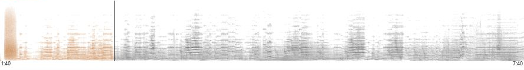
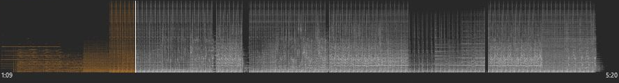

# Better AIMP

Неофициальный плагин для **AIMP 6 Beta 8 x64 (6.00.3097)**. Показывает спектрограмму текущего локального трека в полосе перемотки. Сначала отображается грубый кадр на всю длину трека, затем уточняются промежуточные столбцы.

- Серый спектр и пройденный участок в цвете акцента. Щелчок по полосе перематывает трек.
- Фон, оттенки и курсор подстраиваются под оформление Charm во время работы AIMP. Для пройденного участка применяется цветовая схема AIMP.
- Адаптивный размер FFT с множителями ×1, ×2, ×4, ×8 и ×16. По умолчанию ×4.
- Шесть окон FFT и 21 положение частотной шкалы от линейной до логарифмической.
- Четыре высоты полосы и опция выделения играющего трека в фонотеке.
- При активной спектрограмме плагин подменяет расчёт штатной волновой формы.

## Скриншоты

**Светлая тема**



**Тёмная тема**



## Установка

Для спектрограммы **в полосе перемотки** нужна обложка SpectrogramProbe на основе Charm. Штатная обложка использует полосу для волновой формы.

1. Закройте AIMP и скачайте [архив Windows x64 и обложку](https://github.com/HellbringerOnline/Better-AIMP/releases/latest). Файл SpectrogramProbe.acs6 доступен отдельно и входит в архив.
2. Распакуйте архив в папку `Plugins/aimp_spectrum_probe` в профиле AIMP (обычно `%APPDATA%\AIMP`) или в каталоге установленного AIMP. В ней должны лежать DLL и каталог `layouts`.
3. Запустите AIMP, установите скачанный SpectrogramProbe.acs6 через менеджер обложек и выберите визуализацию **Static spectrogram probe**.
4. Параметры доступны в **Настройки → Плагины → Спектрограмма**. Для возврата штатного интерфейса выберите прежнюю обложку и отключите плагин.

Для анализа нужен локальный файл, который декодер AIMP поддерживает с перемоткой.

## Сборка

Нужны Windows, Zig 0.15.2, Python 3 и распакованный [AIMP SDK для Windows](https://aimp.ru/?do=download.file&id=35).

```powershell
.\build.ps1 -Sdk C:\path\to\AIMP-SDK
```

При необходимости укажите пути к инструментам через `-Zig` и `-Python`. Архив появится в `dist`.

Обложка SpectrogramProbe основана на Charm. AIMP и Charm принадлежат их правообладателям.
